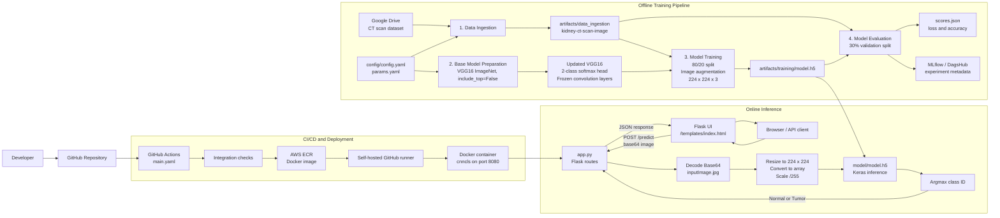
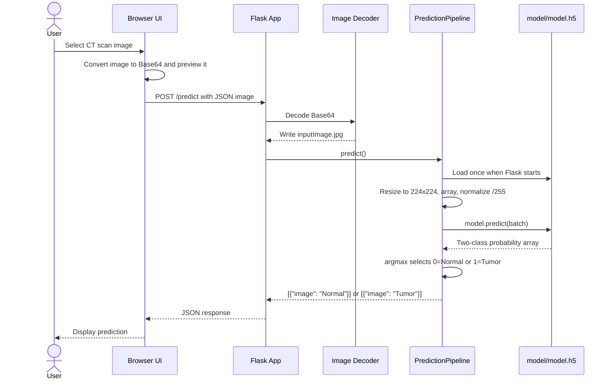
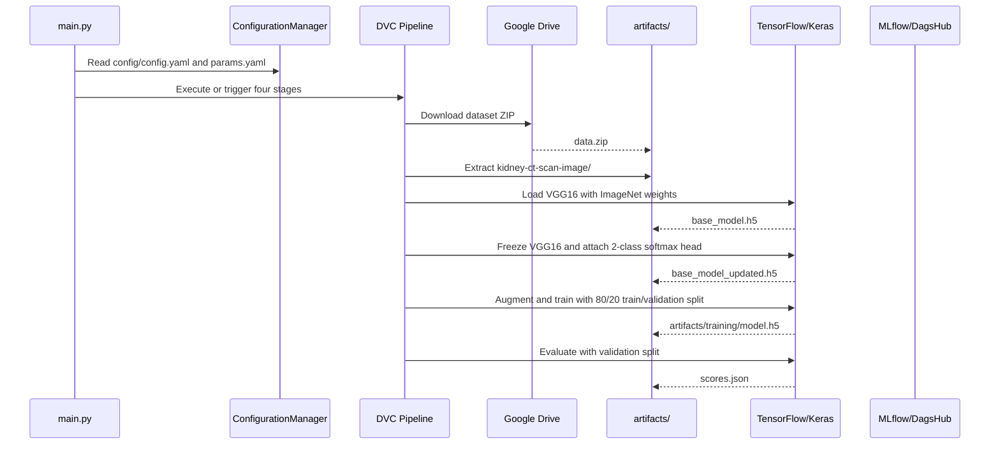

# Kidney Disease Classification - End-to-End MLOps Project

## Live Demo

https://mlops-kidney-disease-cnn.onrender.com

This application predicts whether an uploaded kidney CT scan image is Normal or Tumor.

## What We Built

This project is a full end-to-end MLOps implementation for kidney disease image classification, including:

- Data and pipeline versioning with DVC
- Experiment tracking with MLflow
- Deep learning training and inference using TensorFlow/Keras
- Flask web application for real-time predictions
- Dockerized application for consistent local container runs
- Python-based testing for CI validation
- GitHub Actions CI/CD pipeline
- AWS ECR image delivery with deployment on a self-hosted runner

## Model and Results

- Model type: CNN with transfer learning (VGG16 base)
- Input image size: 224 x 224
- Classes: Normal, Tumor
- Latest tracked metrics:
    - Accuracy: 0.8561
    - Loss: 0.2790

## Core Tech Stack

- Python 3.10
- TensorFlow / Keras
- Flask
- DVC
- MLflow
- Docker
- GitHub Actions
- AWS ECR
- AWS EC2 or other self-hosted runner

## Project Architecture

### Complete End-to-End Architecture



### Request and Training Data Flow





### Training Pipeline Stages

| Stage | Input | Processing | Output |
|---|---|---|---|
| Data ingestion | Google Drive source URL | Download ZIP with `gdown`, extract dataset | `artifacts/data_ingestion/kidney-ct-scan-image/` |
| Base model preparation | VGG16 + `params.yaml` | Remove the original classification head, freeze convolutional layers, add a 2-class softmax head | `base_model.h5`, `base_model_updated.h5` |
| Model training | Extracted images + updated model | Rescale pixels, augment training images, use an 80/20 train/validation split, train for 9 epochs | `artifacts/training/model.h5` |
| Evaluation | Trained model + images | Evaluate on the validation subset and write loss/accuracy | `scores.json` |

The pipeline is reproducible through DVC. `dvc.yaml` tracks stage dependencies, parameters, outputs, and `scores.json` as a metric. `dvc.lock` records the hashes and file counts of a reproduced run. Run all stages with `python main.py` or `dvc repro`.

### Serving Architecture

- `app.py` creates the Flask application and initializes `PredictionPipeline` once.
- The browser previews an uploaded image and sends its Base64 representation to `POST /predict`.
- `decodeImage()` writes the payload to `inputImage.jpg`.
- `PredictionPipeline` loads `model/model.h5`, resizes the image to 224 x 224, scales pixels to `[0, 1]`, adds a batch dimension, and runs inference.
- `argmax` maps output index `0` to `Normal` and index `1` to `Tumor`.
- `GET /` renders the HTML interface. `GET/POST /train` is also available and runs `python main.py`.

### Deployment Architecture

```mermaid
flowchart LR
    PUSH["Push to main"] --> GH["GitHub Actions\nmain.yaml"]
    GH --> CI["Integration job"]
    CI --> BUILD["Configure AWS credentials\nand Amazon ECR login"]
    BUILD --> IMG["docker build\nDockerfile"]
    IMG --> ECR["Push :latest to AWS ECR"]
    ECR --> SELF["Self-hosted GitHub runner"]
    SELF --> PULL["Pull latest ECR image"]
    PULL --> STOP["Stop/remove cnncls if running"]
    STOP --> RUN["docker run\n-p 8080:8080\n--name cnncls"]
    RUN --> APP["Flask app in container"]
    APP --> CLIENT["Browser/API user"]
```



The Docker image uses `python:3.10.19-slim`, installs dependencies, copies the application, exposes port `8080`, and starts `python app.py`. The Flask server reads `PORT` when available and otherwise listens on port `8080`.

## Local Development Setup

### Prerequisites

- Python 3.10
- Conda (recommended)
- Git

### Clone and Install

```bash
git clone https://github.com/Kallappa2005/MLOPS_KIDNEY_DISEASE_CNN
cd MLOPS_KIDNEY_DISEASE_CNN

conda create -n kidneyCnnenv python=3.10 -y
conda activate kidneyCnnenv

pip install -r requirements.txt
```

### Run Training Pipeline

```bash
python main.py
```

### Run Web Application

```bash
python app.py
```

Open the local URL shown in terminal and upload an image for prediction.

## DVC Usage

DVC is used to version data and pipeline outputs, making experiments reproducible.

Useful commands:

```bash
dvc init
dvc repro
dvc dag
dvc status
dvc metrics show
dvc add <path>
dvc push
dvc pull
dvc checkout
```

## MLflow Tracking

MLflow is used to log experiments, metrics, and model performance over runs.

Run MLflow UI locally:

```bash
mlflow ui
```

Optional DagsHub integration example:

```python
import dagshub

dagshub.init(
        repo_owner="kallappakabbur874",
        repo_name="MLOPS_KIDNEY_DISEASE_CNN",
        mlflow=True
)
```

## Docker Setup

This project includes a Dockerfile for containerized runs.

Build image:

```bash
docker build -t kidney-cnn:local .
```

Run container:

```bash
docker run -d --name kidney-cnn -p 8080:8080 kidney-cnn:local
```

Stop and remove:

```bash
docker stop kidney-cnn
docker rm kidney-cnn
```

## Python Testing

CI currently runs smoke tests from tests/test_ci_smoke.py.

Run tests locally:

```bash
python -m unittest discover -s tests -p "test_*.py" -v
```

## GitHub CI/CD

Workflow file: `.github/workflows/main.yaml`

The workflow runs only for pushes to `main` and ignores README-only updates.

Pipeline behavior:

1. Integration job starts after checkout.
2. Continuous Delivery configures AWS credentials and logs in to Amazon ECR.
3. GitHub Actions builds the Docker image and pushes `latest` to the configured ECR repository.
4. A self-hosted runner pulls the image.
5. The runner stops and removes the existing `cnncls` container if present.
6. The runner starts a new container on port `8080`.

Required GitHub secrets:

- `AWS_ACCESS_KEY_ID`
- `AWS_SECRET_ACCESS_KEY`
- `AWS_REGION`
- `ECR_REPOSITORY_NAME`
- `AWS_ECR_LOGIN_URI`

The current integration job is configured as a workflow placeholder: linting and unit-test steps currently only print status messages. The Python smoke tests under `tests/` should be invoked explicitly before production deployment when strengthening this workflow.

## Project Structure

High-level folders and files:

- src for ML components, configs, entities, pipelines, and utilities
- config for central YAML configuration
- artifacts for generated datasets and models
- model for deployable model artifacts
- templates for frontend HTML
- tests for CI test cases
- app.py for Flask app and endpoints
- main.py for training pipeline execution

## Future Improvements

- Add unit tests for each pipeline component
- Add integration tests for predict endpoint
- Add model confidence score in UI response
- Add model registry and version promotion flow
- Add environment-specific deployment workflows